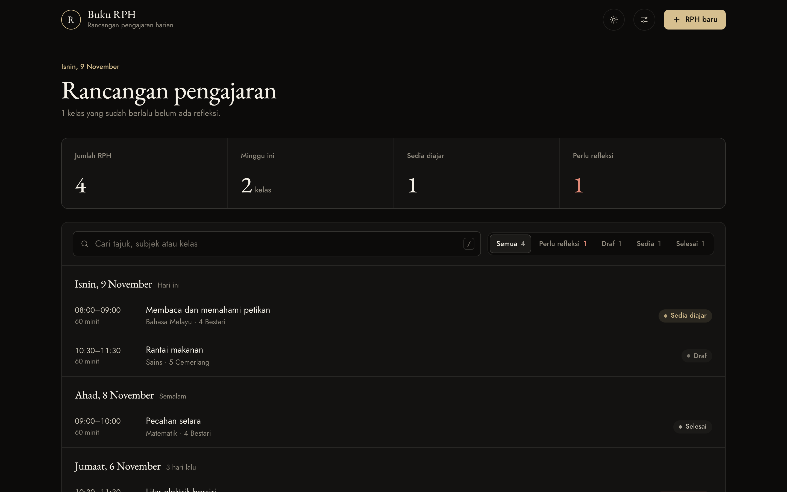
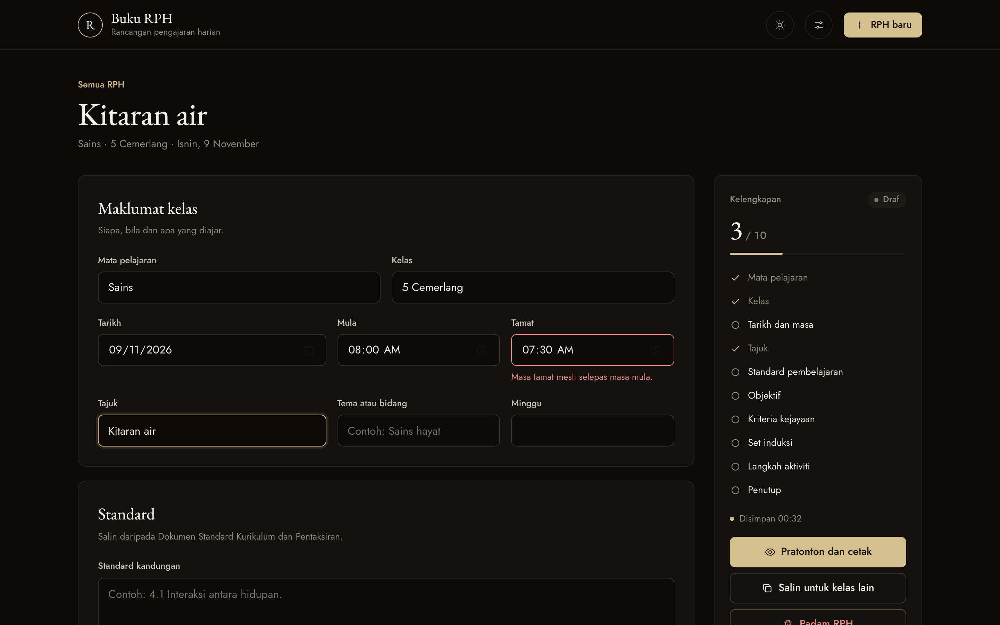
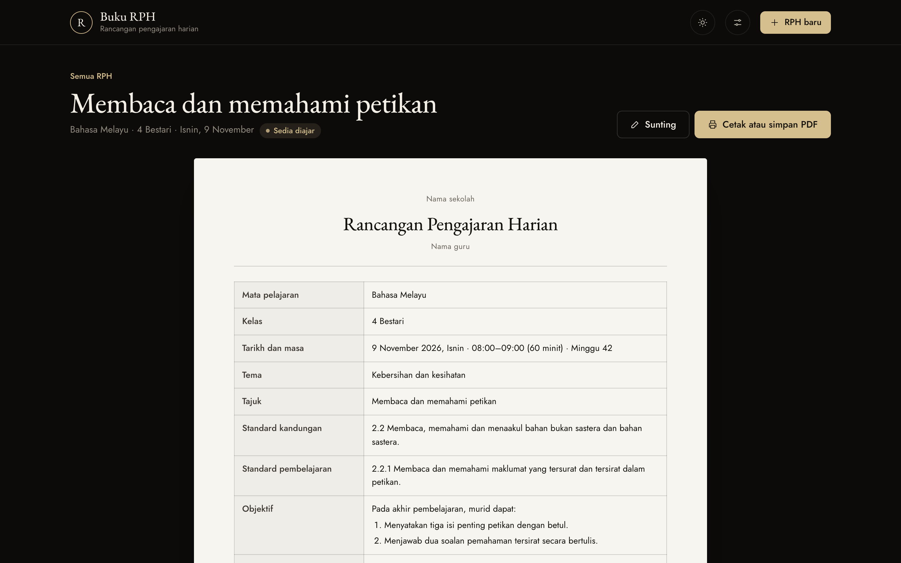

# Buku RPH

[](https://github.com/marvinkeene-dua/buku-rph/actions/workflows/ci.yml)

A lesson-plan workbook for Malaysian primary-school teachers. It checks that each daily lesson plan (*Rancangan Pengajaran Harian*, RPH) is complete before class, reminds the teacher to write a reflection after it, and prints the plan in the A4 table layout that schools expect.

**Live demo:** https://marvinkeene-dua.github.io/buku-rph/ · The interface is in Bahasa Melayu, the language its users write RPH in.



## The problem

Teachers in Malaysian schools write an RPH for every lesson they teach. It records the learning standard, the objectives, success criteria, activities, materials and a reflection written after the lesson. Most teachers do this in a Word template or an exercise book, which leads to three recurring problems:

1. **Plans go into class incomplete.** Nothing tells you that the success criteria or the closing activity are still blank.
2. **Reflections are forgotten.** The reflection is written after class, so it is easy to lose track of which lessons still need one.
3. **The same lesson is retyped** for every parallel class (4 Bestari, 4 Cemerlang and so on).

## What it does

| Problem | Feature |
|---|---|
| Incomplete plans | A ten-point completeness check updates as you type. Each missing item is a link that jumps to its field. A plan is only marked *Sedia diajar* (ready to teach) when all ten pass. |
| Forgotten reflections | Any past lesson without a reflection is flagged *Perlu refleksi* (needs reflection), counted on the home screen and filterable. |
| Retyping | *Salin untuk kelas lain* copies a plan with the class and reflection cleared. |
| Paperwork | A print view in the familiar RPH table, with signature lines, that saves to PDF from the browser. |

Also: autosave, search (press `/`), status filters, undo on delete, JSON backup and restore, light and dark themes, and a phone layout.

| Editor with live checklist and validation | Print view |
|---|---|
|  |  |

## Engineering decisions

**Status is derived, never stored.** `status(plan, today)` is computed from the plan's fields and the current date (`src/lib/rph.js`). A stored status would drift: a plan written on Friday would still say "ready" on Monday after the lesson had passed. Deriving it keeps a single source of truth and makes the rule testable in one place.

**A pure, type-checked domain layer.** Everything that decides something (completeness, status, validation, search, grouping, backup parsing) lives in `src/lib/` with no DOM or storage access. It is typed with JSDoc and checked by `tsc --strict` without a compile step, and covered by unit tests. The DOM layer (`src/views/`) only renders and forwards events; it is covered by end-to-end tests.

**No framework.** The app is a set of forms and lists with little shared interactive state, so a framework would mostly add weight. The production bundle is **12 KB of gzipped JavaScript**. The trade-off is manual rendering, which I kept manageable with one delegated listener per event type, small view modules, and HTML escaping on every interpolated value (`esc()`, tested against an injection string).

**Dates are local calendar strings.** Dates are stored as `YYYY-MM-DD` and never pass through UTC. Converting with `toISOString()` shifts dates by a day between midnight and 08:00 in Malaysia (UTC+8), a bug the tests pin down.

**Local-first storage.** Teachers can start without an account, and their plans are not sent anywhere. The cost is that data lives in one browser, so there is an export and import. Import is tolerant of older backups: missing fields are filled with defaults and malformed records are rejected with the record number (`bacaSandaran`).

**Autosave without empty records.** Edits save after a 500 ms pause, on `Cmd/Ctrl+S`, and when you leave the page. A new plan is only written after its first keystroke, so opening "new" and backing out leaves nothing behind.

**Routes that work on static hosting.** Routes are flat hashes (`#edit-<id>`, `#lihat-<id>`), so the build runs on GitHub Pages or from any sub-path without server rewrites (`base: './'`).

**Accessibility.** Every field has a visible label, errors appear under their field with `aria-invalid` and `aria-describedby`, focus moves to the first field on a new plan and to the content on navigation, dialogs trap focus and close on Escape, and motion is reduced when the system asks for it.

## Architecture

```
src/
├── lib/            Pure domain logic, type-checked (no DOM)
│   ├── rph.js        model, completeness, status, search, backup parsing
│   ├── tarikh.js     local-calendar date helpers
│   └── teks.js       escaping, ids
├── views/          One module per screen: render + handle its events
│   ├── senarai.js    list
│   ├── penyunting.js editor, autosave
│   ├── pratonton.js  print view
│   └── tetapan.js    settings, backup
├── ui/             Toast, modal, icons
├── keadaan.js      App state (single source of truth)
├── storan.js       localStorage wrapper that never throws
└── main.js         Routing and delegated events
```

## Testing

| Layer | Tool | What it covers |
|---|---|---|
| Domain | Vitest, 32 tests | Status transitions, completeness edge cases (whitespace-only rows, end time before start), search and sort order, week boundaries, month and leap-year date maths, backup validation, HTML escaping |
| Types | `tsc --strict --checkJs` | `src/lib/**` |
| End to end | Playwright, 19 tests | Every user flow against the **production build**, at desktop and phone sizes; fails on any console error |
| CI | GitHub Actions | Lint, typecheck, unit and end-to-end tests on every push; the main branch deploys to GitHub Pages |

## Running it

```bash
npm install
npm run dev          # http://localhost:5173
npm run check        # lint + typecheck + unit tests + build
npm run test:e2e     # Playwright (uses your installed Chrome locally)
```

## What I would build next

- **Sync across devices.** A small backend so plans follow the teacher from school laptop to phone.
- **Curriculum lookup.** Pick the learning standard from the official DSKP list instead of typing it.
- **Week view.** Plan the week's timetable at once, which is how most teachers prepare on Sunday night.
- **Reflection insights.** Show which objectives are often not met, by class, across a term.
